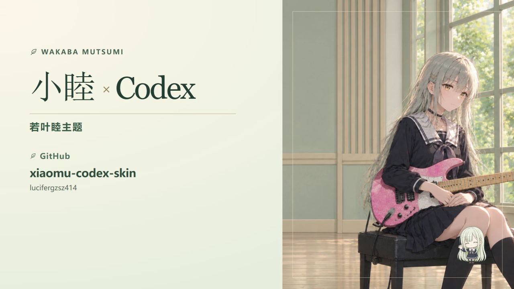

# 小睦 Codex Skin

给自己常用的 Codex 换了套小睦皮肤，也放出来分享给喜欢她的同好。配色用了浅绿和奶白，首页是窗边的小睦，侧栏和卡片里也放了她的 Q 版表情。

打开时有五秒的雨景片头，首页也做了能循环播放的窗边动画。聊天、终端、文件对比和快捷键都可以照常用，平时怎么用 Codex，现在还怎么用。

当前版本：**1.0.4 正式版**

[下载安装包](https://github.com/lucifergzsz414/xiaomu-codex-skin/releases/download/v1.0.4/xiaomu-codex-skin-20261123-4957-v1.0.4.zip) · [发布说明](https://github.com/lucifergzsz414/xiaomu-codex-skin/releases/tag/v1.0.4) · [日常使用与反馈](docs/BETA-TRYOUT.md) · [设计说明](docs/DESIGN.md) · [全部发布](https://github.com/lucifergzsz414/xiaomu-codex-skin/releases)

## 一分钟看看

[](https://www.bilibili.com/video/BV1gXsH6CE1D/)

配了小睦的声音和中文字幕，音乐是《未完成ランデヴー Music box ver.》。点封面在 B 站观看，也可以 [下载原片](https://github.com/lucifergzsz414/xiaomu-codex-skin/releases/download/v1.0.3/xiaomu-codex-promo-60s.mp4)。

## 装上之后

- 正常从「小睦 Codex」启动，会播一次五秒静音雨景片头。想直接开始，点“跳过”或按 Esc。
- 首页的窗边动画八秒一轮，可以手动暂停；窗口失焦或收窄时也会自动停下。
- 找文件、搜文本时，会记住这个聊天选过的项目目录，下次不用再选一遍。
- 桌面上的「小睦 Codex」用来启动，「小睦皮肤管理」用来暂停、恢复、修复和更新。开始菜单里也能找到管理入口。

## 使用前准备

| 项目 | 要求 |
| --- | --- |
| 系统与客户端 | Windows x64；Microsoft Store Codex **26.1117.4957.0** |
| Node.js | **22 或更高版本**，安装在默认目录 `C:\Program Files\nodejs` |
| Codex 外观 | 在 Codex 原生设置中选择**浅色主题** |

## 安装与恢复

1. 下载完整安装包并解压，保留原压缩包与解压目录。
2. 双击 `skin\manage.vbs`，选择“安装 / 修复”（详细步骤见包内 `START-HERE.md`）。
3. 保存手头的工作，正常退出 Codex，再从桌面「小睦 Codex」打开。

平时想暂时切回原版，打开桌面或开始菜单的「小睦皮肤管理」即可暂停或恢复。选择“恢复官方外观”会撤下皮肤并恢复受管入口，已经打开的 Codex 窗口、专用小睦入口和备份都会保留。

## 更新皮肤

**已经装好 1.0.3：**在「小睦皮肤管理」里点“检查更新”→“下载并更新”。管理器会下载正式版、校验安装包并备份旧安装，完成后重新打开管理窗口；无需登录 GitHub，也不用安装 `gh`。

**从 1.0.2 或更早版本升级：**下载并完整解压 1.0.4，关闭旧管理窗口，再打开新包的 `skin\manage.vbs`，点“安装 / 修复”，一起换上修正后的更新程序。Codex 可以保持打开，运行中的任务会保留。

更新后皮肤保持暂停，检测通过后点“启动 / 继续”即可。Codex 窗口和运行中的任务会保留。只有点击按钮时才联网检查，不影响日常启动。

旧版发布和安装包继续保留在 [全部发布](https://github.com/lucifergzsz414/xiaomu-codex-skin/releases) 中。

需要手动更新时，备用命令和恢复步骤见 [完整使用说明](integration-v1/release-v1/USAGE.md)。管理窗口显示产品版本 1.0.4。

1.0.4 主要优化切换聊天、设置和菜单时的开销：减少重复检查，相同头像资源只保存一份。浅绿主题、片头、背景和原来的操作方式照旧。详见 [1.0.4 更新说明](integration-v1/release-v1/RELEASE-NOTES-1.0.4.md)。

## 从源码构建

日常使用直接下载上面的 Release 安装包即可。需要自行构建时，可使用 [1.0.4 标签源码](https://github.com/lucifergzsz414/xiaomu-codex-skin/tree/v1.0.4)，在 Windows 下准备 Node.js 22+、Windows PowerShell 和系统自带的 .NET Framework C# 编译器，在仓库根目录依次执行：

```powershell
node .\integration-v1\native-v1\build-native.cjs
node .\integration-v1\release-v1\build-release.cjs
```

生成结果位于 `integration-v1\release-v1\package`。

## 来源与反馈

上游辅助脚本沿用 Codex Dream Skin Studio 的 MIT 许可，完整说明见 [第三方与素材说明](THIRD-PARTY-NOTICES.md)、[素材来源](integration-v1/release-v1/ASSET-SOURCES.md) 与 [素材清单](integration-v1/release-v1/asset-ledger.json)。

遇到问题时，欢迎通过 [反馈表](https://github.com/lucifergzsz414/xiaomu-codex-skin/issues/new?template=skin-problem.yml) 写下版本号、操作步骤和实际表现；附截图前记得遮住私人内容。
